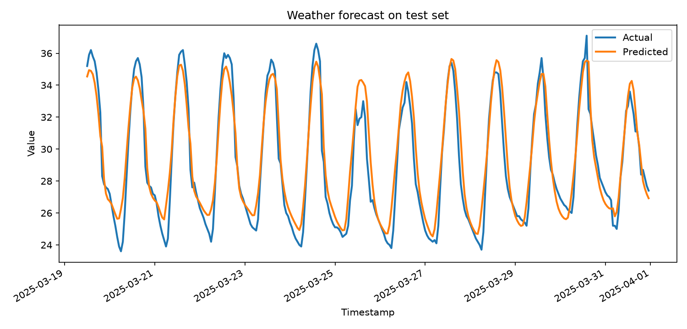
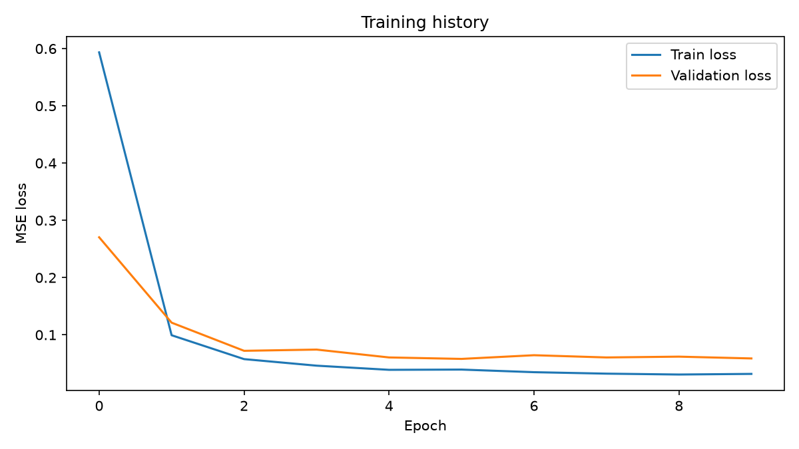

# Dự báo nhiệt độ bằng RNN, LSTM và GRU

Dự án học sâu cho chuỗi thời gian: tải dữ liệu thời tiết theo giờ từ **Open-Meteo**, tạo cửa sổ quan sát lịch sử và huấn luyện mô hình **PyTorch** để dự đoán một giá trị nhiệt độ tại chân trời được chọn.



Đây là biểu đồ từ lần chạy thật với dữ liệu TP.HCM trong quý I/2025. Dự án hiện đánh giá dự báo trên dữ liệu lịch sử được giữ lại, chưa cung cấp ứng dụng/web hoặc dịch vụ dự báo thời tiết trực tiếp.

## Dự án giải quyết bài toán gì?

Với cấu hình mặc định, mô hình nhận **24 quan sát theo giờ liên tiếp** và dự đoán `temperature_2m` của **giờ tiếp theo**. Đầu vào gồm nhiệt độ quá khứ, các biến thời tiết bổ sung và đặc trưng thời gian tuần hoàn.

Ví dụ: dùng quan sát từ 00:00 đến 23:00 ngày hôm trước để dự đoán nhiệt độ lúc 00:00 ngày hôm sau. `--forecast-horizon 6` chuyển mục tiêu sang thời điểm cách quan sát cuối 6 bước; mô hình vẫn trả về **một giá trị**, không phải toàn bộ 6 giờ.

| Khả năng | Trạng thái |
| --- | --- |
| Tải dữ liệu lịch sử theo tọa độ và khoảng ngày | Có, Open-Meteo Historical Weather API |
| Chọn RNN / LSTM / GRU | Có, một mô hình mỗi lần chạy |
| Chuẩn hóa, chia dữ liệu theo thời gian, tạo cửa sổ | Có |
| Biểu đồ loss, dự đoán và chỉ số MAE/RMSE | Có |
| Dự báo nhiều bước thành một chuỗi tương lai | Chưa có |
| API, giao diện web, triển khai hoặc inference CLI riêng | Chưa có |

## Kết quả minh họa có thể tái tạo

| Cấu hình | Giá trị |
| --- | --- |
| Địa điểm | TP.HCM, `10.8231, 106.6297` |
| Dữ liệu | 01/01/2025–31/03/2025, múi giờ `Asia/Ho_Chi_Minh` |
| Số dòng | 2.160; train 1.512 / validation 324 / test 324 |
| Mô hình | LSTM, hidden size 64, 2 lớp, dropout 0,1 |
| Huấn luyện | 10 epoch, batch size 32, Adam, learning rate 0,001, seed 42 |
| Đầu vào / mục tiêu | 24 bước / 1 bước; 12 đặc trưng |
| Thiết bị | CPU, Python 3.11.15, PyTorch 2.5.1+cpu, NumPy 1.26.4 |
| MAE trên test | **0,9234 °C** |
| RMSE trên test | **1,1695 °C** |



Lần chạy minh họa ngày 05/11/2026 tạo 300 dự đoán trên tập test sau khi tạo cửa sổ. [metrics.json](docs/media/metrics.json) và [predictions.csv](docs/media/predictions.csv) lưu kết quả thực tế; số liệu có thể thay đổi theo phiên bản thư viện, thiết bị và dữ liệu API. Đây là một lần chạy minh họa, chưa phải kết luận mô hình tốt hơn baseline hoặc phương pháp khác. Các giới hạn của pipeline được nêu bên dưới.

## Cài đặt

Cấu hình đã chạy minh họa: Python 3.11 và PyTorch trên CPU. Không bắt buộc có GPU; cần Internet để tải dữ liệu.

```bash
git clone https://github.com/thanq204/Du_Bao_Thoi_Tiet.git
cd Du_Bao_Thoi_Tiet
python -m venv .venv
```

Kích hoạt môi trường:

```powershell
# Windows PowerShell
.\.venv\Scripts\Activate.ps1
```

```bash
# Linux / macOS
source .venv/bin/activate
```

Cài thư viện:

```bash
python -m pip install --upgrade pip
python -m pip install -r requirements.txt
```

Để dùng cùng phiên bản torch/numpy với lần chạy minh họa trên CPU, cài thay bằng:

```bash
python -m pip install torch==2.5.1 --index-url https://download.pytorch.org/whl/cpu
python -m pip install "numpy==1.26.4" matplotlib requests
```

## Chạy từ đầu đến cuối

Chạy các lệnh sau từ thư mục gốc dự án. Mỗi lệnh được viết trên một dòng để dùng được trong PowerShell và Bash.

### 1. Tải dữ liệu theo giờ

```bash
python scripts/fetch_weather_data.py --latitude 10.8231 --longitude 106.6297 --start-date 2025-01-01 --end-date 2025-03-31 --timezone Asia/Ho_Chi_Minh
```

Dữ liệu được ghi vào `data/weather_data.csv`; script tự tạo thư mục. Thay tọa độ và khoảng ngày để thử địa điểm khác. Các tùy chọn bổ sung gồm `--hourly`, `--output-path` và `--timeout` (mặc định 30 giây). Mặc định `--timezone auto`; ví dụ trên chỉ định múi giờ để dễ tái tạo.

### 2. Huấn luyện và xuất kết quả

```bash
python train.py --data-path data/weather_data.csv --model lstm --epochs 10 --device cpu --output-dir artifacts/demo
```

Đây là lệnh dùng cho minh họa. Chạy `python train.py` không tham số sử dụng 30 epoch, `--device auto` và thư mục `artifacts/`.

Để thử với đúng bản dữ liệu đã tải cho minh họa, không cần gọi lại API:

```bash
python train.py --data-path docs/media/weather_data.csv --model lstm --epochs 10 --device cpu --output-dir artifacts/demo
```

### 3. So sánh các kiến trúc

```bash
python train.py --model rnn --epochs 10 --output-dir artifacts/rnn
python train.py --model lstm --epochs 10 --output-dir artifacts/lstm
python train.py --model gru --epochs 10 --output-dir artifacts/gru
```

Dùng cùng dữ liệu, seed và cấu hình để so sánh. Mỗi lần chạy chỉ huấn luyện một mô hình; thư mục riêng giúp tránh ghi đè `metrics.json`, biểu đồ và CSV.

### 4. Đổi cửa sổ và chân trời dự báo

```bash
python train.py --model gru --sequence-length 48 --forecast-horizon 6 --epochs 20 --output-dir artifacts/gru_6h
```

Với dữ liệu đều theo giờ, lệnh này dùng 48 giờ lịch sử để dự đoán một giá trị ở thời điểm cách quan sát cuối 6 giờ. Với CSV có tần suất khác, các tham số được hiểu là **số dòng/bước**, không tự động là số giờ.

## Dữ liệu đầu vào

CSV tối thiểu phải có `timestamp` và `temperature_2m`:

```csv
timestamp,temperature_2m
2025-01-01T00:00,25.1
2025-01-01T01:00,24.8
2025-01-01T02:00,24.5
```

Ba dòng trên chỉ minh họa định dạng, không đủ để huấn luyện. Mỗi phần train/validation/test phải có ít nhất `sequence_length + forecast_horizon` dòng. Với cấu hình 24/1 và tỷ lệ 70/15/15, nên cung cấp nhiều ngày hoặc nhiều tháng dữ liệu liên tục.

Các biến mặc định được tải:

| Cột | Ý nghĩa |
| --- | --- |
| `temperature_2m` | Nhiệt độ không khí ở độ cao 2 m, mục tiêu mặc định (°C) |
| `relative_humidity_2m` | Độ ẩm tương đối ở độ cao 2 m |
| `dew_point_2m` | Nhiệt độ điểm sương |
| `pressure_msl` | Áp suất quy về mực nước biển |
| `precipitation` | Lượng giáng thủy |
| `cloud_cover` | Độ che phủ mây |
| `wind_speed_10m` | Tốc độ gió ở độ cao 10 m |
| `wind_direction_10m` | Hướng gió ở độ cao 10 m |

Mã tạo thêm `hour_sin`, `hour_cos`, `dayofyear_sin`, `dayofyear_cos`. Mặc định dùng tất cả các cột ngoài thời gian làm đặc trưng, gồm cả nhiệt độ lịch sử.

Chọn bớt đặc trưng:

```bash
python train.py --feature-columns temperature_2m,relative_humidity_2m,pressure_msl --output-dir artifacts/subset
```

Cột mục tiêu được tự thêm vào đầu vào nếu chưa có; đặc trưng thời gian vẫn được thêm trừ khi dùng `--no-time-features`. Với CSV tự chuẩn bị, chỉ nên giữ các cột số ngoài cột thời gian: loader xử lý mọi cột trước khi chọn đặc trưng, nên một cột văn bản hoàn toàn có thể gây lỗi.

## Pipeline và kiến trúc


- Timestamp không hợp lệ bị bỏ; timestamp trùng giữ bản ghi cuối.
- Dữ liệu thiếu được nội suy tuyến tính theo chỉ số dòng; hai đầu dùng giá trị hợp lệ gần nhất.
- Scaler chuẩn hóa đầu vào và mục tiêu theo mean/std của tập train.
- Tỷ lệ mặc định là 70% train, 15% validation, phần còn lại test. Chỉ DataLoader train được xáo trộn; việc chia tập vẫn theo thứ tự thời gian.
- Loss là MSE trên mục tiêu đã chuẩn hóa, tối ưu bằng Adam; MAE/RMSE được tính sau khi đổi về đơn vị nhiệt độ gốc.

## Tham số huấn luyện

| Tham số | Mặc định | Ý nghĩa |
| --- | --- | --- |
| `--data-path` | `data/weather_data.csv` | Đường dẫn CSV |
| `--time-column` / `--target-column` | `timestamp` / `temperature_2m` | Tên cột thời gian / mục tiêu |
| `--feature-columns` | Rỗng | Danh sách tên cột phân cách bằng dấu phẩy |
| `--no-time-features` | Tắt | Bật cờ này để bỏ đặc trưng thời gian |
| `--model` | `lstm` | `rnn`, `lstm` hoặc `gru` |
| `--epochs` / `--batch-size` | `30` / `32` | Số vòng học / kích thước batch |
| `--sequence-length` / `--forecast-horizon` | `24` / `1` | Chiều dài đầu vào / khoảng cách đến mục tiêu |
| `--hidden-size` / `--num-layers` | `64` / `2` | Kích thước ẩn / số lớp recurrent |
| `--dropout` / `--lr` | `0.1` / `0.001` | Dropout / learning rate |
| `--train-ratio` / `--val-ratio` | `0.7` / `0.15` | Tỷ lệ chia dữ liệu |
| `--seed` | `42` | Seed ngẫu nhiên |
| `--device` | `auto` | Tự chọn CUDA nếu có, ngược lại CPU; có thể chỉ định `cpu`/`cuda` |
| `--output-dir` | `artifacts` | Thư mục lưu kết quả |

Xem toàn bộ tùy chọn bằng `python train.py --help` hoặc `python scripts/fetch_weather_data.py --help`.

## Các file đầu ra

| File | Nội dung |
| --- | --- |
| `<model>_weather_forecast_model.pt` | `state_dict` của mô hình |
| `metrics.json` | Cấu hình, đặc trưng, số dòng, test loss, MAE và RMSE |
| `loss_curve.png` | Loss train và validation qua từng epoch |
| `forecast_plot.png` | Nhiệt độ thực tế và dự đoán trên test |
| `predictions.csv` | `timestamp`, `actual`, `predicted`, `error` |

`error = predicted - actual`: dương là dự đoán cao hơn thực tế. MAE/RMSE càng thấp càng tốt trên **cùng tập đánh giá và đơn vị**; loss chuẩn hóa không đọc trực tiếp thành °C. Thư mục `data/` và `artifacts/` được Git bỏ qua; bản minh họa chọn lọc nằm trong `docs/media/`.

## Giới hạn cần biết khi đánh giá

- Chưa có baseline persistence, cross-validation theo thời gian hoặc đánh giá nhiều seed.
- Nội suy được thực hiện **trước khi chia tập**, nên dữ liệu có giá trị thiếu quanh ranh giới có thể dùng thông tin từ phần sau. Cần xử lý theo từng split nếu dùng để báo cáo thực nghiệm nghiêm ngặt.
- Mã có ý định giữ epoch tốt nhất theo validation, nhưng `best_state` dùng `detach().cpu()` mà chưa clone. Khi chạy CPU, tensor có thể chia sẻ bộ nhớ với model, nên checkpoint chưa đảm bảo là epoch tốt nhất; số liệu minh họa phản ánh đúng mã hiện tại.
- Loader không tự bổ sung timestamp bị khuyết hoặc resample về tần suất giờ. Cần kiểm tra dữ liệu đều bước trước khi diễn giải chân trời dự báo.
- Checkpoint chỉ chứa trọng số, chưa lưu mean/std của scaler hoặc toàn bộ pipeline inference. Muốn dùng riêng cho dữ liệu mới cần bổ sung lưu/nạp scaler và đúng thứ tự đặc trưng.
- Dự đoán test dùng các cửa sổ lịch sử thực tế, không phải dự báo tự hồi quy toàn bộ giai đoạn tương lai. Chưa có khoảng tin cậy hoặc dự báo xác suất.

## Cấu trúc dự án

```text
Du_Bao_Thoi_Tiet/
├── train.py                       # CLI huấn luyện, đánh giá, lưu artifacts
├── requirements.txt
├── scripts/fetch_weather_data.py   # Open-Meteo → CSV
├── src/
│   ├── data.py                    # Làm sạch, scaler, chia tập, cửa sổ
│   ├── models.py                  # RecurrentForecaster
│   └── utils.py                   # Seed, device, metrics, biểu đồ, CSV
└── docs/media/                    # Kết quả thật được chọn cho README
```

## Xử lý lỗi thường gặp

| Lỗi / hiện tượng | Hướng xử lý |
| --- | --- |
| `Data file not found` | Chạy script tải dữ liệu trước, kiểm tra `--data-path` và thư mục hiện tại |
| `Missing required columns` | Kiểm tra header hoặc đặt `--time-column`/`--target-column` đúng |
| `Not enough rows to create sequences` | Tăng số ngày dữ liệu hoặc giảm cửa sổ/chân trời; kiểm tra cả validation và test |
| `contains only missing values` | Loại cột văn bản/rỗng hoàn toàn hoặc bổ sung dữ liệu số |
| Lỗi HTTP / timeout | Kiểm tra Internet, tọa độ, khoảng ngày; tăng `--timeout` hoặc thử lại sau |
| CUDA không khả dụng | Dùng `--device cpu` hoặc để `--device auto` |

## Nguồn dữ liệu

Dữ liệu lịch sử lấy từ [Open-Meteo Historical Weather API](https://open-meteo.com/en/docs/historical-weather-api), do [Open-Meteo](https://open-meteo.com/) cung cấp theo [CC BY 4.0](https://creativecommons.org/licenses/by/4.0/). Biểu đồ và CSV minh họa là kết quả xử lý/huấn luyện từ dữ liệu này; không phải bản tin dự báo chính thức. Chi tiết lần chạy tại [docs/media/README.md](docs/media/README.md).
